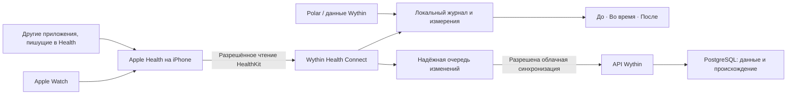

# Wythin Health Connect — проект интеграции Apple Health

Дата: 2026-11-15. Статус: проект решения для согласования; реализация не начата.
Рабочая ветка: `codex/apple-health-integration`, база: локально доступный `origin/main`, `62c0cd3`.

## Задача

Пользователь записывает физические активности привычным способом — на Apple Watch или в приложении, которое сохраняет тренировки в Apple Health. Wythin самостоятельно получает доступные записи, добавляет их в журнал, размечает интервалы и показывает измерения до, во время и после нагрузки. Повторно вводить начало, конец и вид тренировки не нужно.

«Отдельный проект» трактуется как самостоятельный модуль Health Connect с собственными моделями, очередью синхронизации, API и тестами внутри репозитория Wythin. Это решение исполнителя, а не уже подтверждённое предпочтение пользователя. Второе приложение для владельца телефона не требуется.

Результат считается достигнутым, когда сохранённая тренировка появляется в Wythin автоматически после её доступности на iPhone, переживает отсутствие сети и перезапуск приложения, а карточка объясняет, какие измерения действительно доступны.

## Подходы

1. **HealthKit в существующем iOS-приложении + отдельный API Wythin.** Выбранное предложение: использует установленное приложение, существующий журнал и Polar-метрики. Модуль можно развивать независимо; системное разрешение выдаётся именно приложению Wythin.
2. **Отдельное приложение-компаньон.** Позволяет иметь другой цикл релизов, но требует второй установки, отдельного разрешения HealthKit и привязки двух приложений. Для автоматизации текущего журнала преимуществ недостаточно.
3. **Импорт XML/файлов экспорта.** Полезен как дополнительный перенос архива, но требует действий пользователя и не решает постоянную синхронизацию.

Прямой запрос backend → Apple Health не является архитектурой этой интеграции: чтение производится через HealthKit на устройстве. Apple Watch — источник внутри HealthKit, отдельное серверное подключение к часам не нужно. Новое watchOS-приложение не входит в первую версию.



## Что уже есть в коде

- SwiftUI + SwiftData: `ios/Wythin/Models/ActivityLog.swift`, `App/WythinApp.swift`.
- `ActivityLog.computeHRVWindows` использует 5 минут до начала, весь интервал активности и 10 минут после завершения. Сейчас читает `HRVSample` от Polar и применяет проверку качества Polar.
- `UI/Activities/ActivityLogging.swift`, список и карточки уже поддерживают завершённые записи. Импорт не должен вызывать `begin()` и закрывать живую сессию пользователя.
- `Sync/ActivityUploader.swift` выбирает записи по `endedAt`. Импорт прошлого и исправление уже загруженных записей требуют независимой очереди изменений.
- `Sync/ActivityRestore.swift` восстанавливает только пустой локальный журнал. Health Connect должен поддерживать слияние и tombstone независимо от этой проверки.
- Backend: FastAPI, asyncpg/PostgreSQL, `/activities` и `/v1/me`. Существующая идентификация мобильного клиента использует общий ключ приложения и `X-User-ID`; выпуск персональных токенов также основан на этом заголовке. Это не доказательство владения учётной записью.
- На проверенной базе нет HealthKit-сервиса, HealthKit entitlements или описания разрешения на чтение Health.

## Объём первой версии

### События

Импортировать все доступные **сохранённые `HKWorkout`**, включая историю, любые виды спорта, сторонние приложения, неизвестные будущие виды и записи, введённые человеком в Health. Сохранять происхождение и признак ручного ввода источником. Не обещать обнаружение движения, которое нигде не записано как тренировка.

Автоматическая разметка определяет тип, начало, конец, паузы/сегменты и источник. Для running использовать нейтральное «Бег», для walking — «Ходьба»: не угадывать `Easy Run`, `Tempo Run` или `Nature Walk` по одному коду Apple. Неизвестный тип сохранять с исходным числовым кодом и нейтральной подписью.

Мультиспорт хранить как одну родительскую тренировку с сегментами; не создавать одновременно родителя и сегменты как независимые упражнения в общих итогах. `workout.duration` хранить отдельно от `end-start`, поскольку паузы уменьшают активную продолжительность. Не применять ограничение ручной формы `ActivityTimeMath.maximumMinutes = 180` к импорту.

### Измерения

| Данные HealthKit | Как используются |
| --- | --- |
| Heart rate | Ряд пульса и описательная статистика окон |
| Heart rate variability SDNN | Отдельный ряд HRV SDNN с единицами ms и источником |
| Active energy burned | Доступная энергия тренировки, kcal |
| Distance walking/running, cycling, swimming | Доступная дистанция, m; исходный вид сохраняется |
| Step count | Доступные шаги в контексте тренировки, без создания выдуманной тренировки из шагов |
| Workout summary / events / activities | Тип, активное время, паузы, сегменты, сводные показатели |

Запрашивать только поддерживаемые на текущей версии iOS типы. Отсутствующий тип или отказ по одному виду данных не блокирует импорт самой тренировки. Сон, питание, маршруты GPS, медицинские записи и новые алгоритмы обнаружения повседневных эпизодов не входят в первую версию. Суточные шаги/кольца активности — отдельное последующее расширение, не дубль тренировок.

## Пользовательский сценарий и согласия

В Settings появляется «Apple Health». Первый запуск не показывает системный запрос самопроизвольно.

1. Пользователь открывает карточку и читает, что Wythin импортирует тренировки и перечисленные измерения для анализа.
2. Нажимает «Подключить Apple Health»; приложение вызывает `requestAuthorization(toShare: [], read: types)`. Запись в Health не запрашивается.
3. При включённом облаке экран отдельно объясняет, что импортированные данные сохраняются на сервере Wythin, и фиксирует согласие именно на эту передачу. Старое согласие на Polar не считается автоматически согласием на новый источник.
4. Импорт начинается локально. Сначала показать недавние доступные тренировки; вся разрешённая история догружается порциями с сохранением прогресса. В интерфейсе нет скрытого ограничения «только 90 дней».
5. Новые записи и дополнения приходят автоматически при доступных фоновых событиях и при возвращении приложения на экран. Доступна кнопка «Синхронизировать сейчас».

Состояния интерфейса: выключено; запрос доступа ещё не показан; импорт истории; обновлено с датой; ожидается отправка; временная ошибка; нет доступных записей. Успешный completion системного запроса означает завершение диалога, а не выдачу всех read-разрешений. Нельзя сообщать «доступ запрещён» только по пустому результату или использовать `authorizationStatus(for:)` как проверку чтения.

При поддержке SDK/OS учитывать ограниченное историческое разрешение. Документированный `getEarliestAuthorizedSampleDate` имеет доступность iOS 27+: не использовать его без проверки компилятора/SDK и `#available`; старые ОС должны работать через обычные запросы. Более ранние записи вне разрешённого периода считаются неизвестными.

Набросок результата (числа ниже иллюстративны):

```text
Бег · Apple Health / Apple Watch
07:30–08:10 · 40 мин · 6,2 км
До: 07:25–07:30 | Во время: 07:30–08:10 | После: 08:10–08:20
Пульс: —       | 146 уд/мин             | 92 уд/мин
До тренировки измерения не найдены
График: разрывы там, где нет измерений
Источник пульса: Apple Watch · Обновлено: 08:24
```

Это эскиз содержания, не согласованный визуальный макет. Оформление продолжает существующую тему приложения.

## Модели и владение данными

Новые сущности SwiftData и соответствующие таблицы PostgreSQL:

- **HealthConnection**: отдельное серверное пространство данных установки Wythin, источник `apple_health`, состояние, согласие на облако и версия текста, epoch подключения, последний успешный обмен. Не хранит утверждение, что все разрешения чтения выданы. Связь с текущим профилем существует локально; публичный device ID не даёт доступа к облачному пространству.
- **HealthWorkout**: UUID объекта Apple, связанный `ActivityLog.id`, source bundle/name/version, безопасные описательные поля устройства, исходный activity type, UTC start/end, IANA timezone если известна, active duration, summaries, events/segments, revision, deletedAt. Не отправлять произвольный словарь metadata или серийные номера устройств.
- **HealthQuantitySample**: UUID родительского HK-объекта, metric type, нормализованные value/unit, start/end, source, представление point/interval/series, deletedAt. Для развёрнутой серии — стабильный child key из parent UUID + порядкового номера элемента; удаление родителя удаляет всю серию.
- **HealthWorkoutSampleLink**: связь измерения с тренировкой/контекстом. Один sample может участвовать в нескольких соседних окнах, хранится при этом один раз.
- **HealthImportCursor**: тип, версия/предикат потока, account/install/epoch, непрозрачный anchor. Anchor принадлежит устройству и никогда не интерпретируется backend.
- **HealthOutboxChange**: UUID операции, поток/sequence, тип upsert/delete, ссылка на неизменяемый payload, попытки, следующая попытка, подтверждение. Курсор и outbox сохраняются атомарно с локальными данными.
- **HealthAnalysis**: версия алгоритма, набор исходных ревизий, оконная статистика с источниками, число измерений/покрытие, состояние pending/available/partial/no_data. Результат можно перестроить.

Ключ идемпотентности объекта: `(owner_id, provider, HealthKit UUID)`. UUID Wythin-активности, однажды выбранный для такого объекта, сохраняется при повторном импорте. Облако возвращает каноническое соответствие при восстановлении.

Локальный `ActivityLog` получает явный `origin` и `externalWorkoutID`, а не пытается кодировать происхождение через `isManual`. Заметки и пользовательское переименование — отдельные поля поверх исходной записи; импорт их не перезаписывает. Новые поля опциональны/с безопасным значением по умолчанию, с тестом миграции настоящей прежней схемы. Нельзя полагаться на удаление локальной базы как способ миграции.

## Синхронизация

### История и инкрементальные изменения

- Включить HealthKit capability, `NSHealthShareUsageDescription`, entitlement фоновой доставки. Подключить observer queries при запуске приложения, в том числе при фоновом запуске, до ожидания появления Settings/Activities.
- Для тренировок использовать `HKAnchoredObjectQuery`, читать добавления и `HKDeletedObject`. Начальный anchor nil; порции ограничены (предложение: 200 объектов), состояние переживает завершение процесса.
- Недавний snapshot может ускорить отображение, но не продвигает основной anchor: полный проход дедуплицирует уже показанные UUID.
- Для метрик первоначально читать объединённые диапазоны `[start-5m, end+10m]` импортированных тренировок и связанные с тренировками samples. Не ограничивать «до/после» предикатом принадлежности workout: контекст часто к нему не привязан.
- Дополнительно вести anchored delta-поток для каждого разрешённого типа метрик с постоянным предикатом, начиная с nil. Первичный проход порциями читает историю; сохраняет только данные в интересующих оконных диапазонах и сведения, нужные для удаления уже сохранённых объектов. Новый workout всегда инициирует собственное чтение окон, поэтому ранее отброшенный sample не теряется для него.
- Курсор метрик обновляется только после сохранения полученных данных, записей outbox и заданий пересчёта. Observer будит обработчик; anchored query сообщает сами изменения. Не ожидать фоновых пробуждений от одной лишь anchored query.
- После локальной транзакции вызвать observer completion; не удерживать его до успешной сетевой отправки. При ошибке чтения/сохранения оставить anchor прежним и зафиксировать повторную попытку. Завершать callback ровно один раз также на ошибке/отмене.
- Чтение/распаковка серий и SwiftData выполняются в выделенном actor/context; UI получает готовые изменения. Ограничить порцию метрик, например 500 объектов, время фоновой работы и объём сетевого запроса. Большой импорт продолжается в следующем доступном запуске.

### Поздние данные, сжатие, сеть

- Watch может передать пульс позже самой тренировки. Вставка/удаление sample помечает все затронутые окна dirty, независимо от возраста тренировки. Пересчёт не ограничен существующим 48-часовым backfill Wythin.
- Исторические quantity samples могут содержать серии. Использовать API quantity series для распаковки; никогда не выдавать среднее всего контейнера за точку. Сохранять interval/coalesced семантику и происхождение. При замене сжатого контейнера удалить дочерние элементы старого и загрузить новый.
- Пропавшая сеть не препятствует локальному журналу. Повторные запросы используют тот же operation ID, sequence и payload. Backoff с jitter; 401/403 останавливают отправку до восстановления авторизации, 429 учитывает Retry-After, 5xx повторяется, 422 не пропускается незаметно.
- Отмена/краш до commit не продвигают anchor. Краш после commit, но до ответа сервера, повторяет сохранённую операцию без дубля. Старый `endedAt` не влияет на отправку.
- Перезапуск, foreground и кнопка ручной синхронизации запускают один и тот же сериализованный drain. Background delivery — доставка по возможности iOS, не обещание мгновенного импорта или непрерывного live-потока с часов.

### Удаления и дубли

- Удаление workout в Health создаёт tombstone и удаляет из видимого журнала только импортированную проекцию; хранить минимальное соответствие UUID для защиты от устаревшего retry. Удалить вычисленные результаты и ненужные sample links; sample, используемый другим окном, сохраняется.
- Удаление sample пересчитывает затронутые карточки. Уменьшение доступных разрешений/пустой запрос не считать удалением данных.
- Повторный UUID всегда upsert. Копии одной тренировки от разных приложений имеют разные UUID: обнаруживать кандидатов по типу, времени и длительности, но не объединять автоматически без доказуемой общей идентичности. Предложить пользователю «это одна тренировка» и сохранить все ссылки на источники.
- Совпадение с ручной активностью Wythin — предложение связать записи. Не удалять заметки, не останавливать активную запись, не вызывать автоматический insight на каждый элемент массового импорта.
- «Отключить» останавливает чтение, фоновые наблюдатели и новые передачи; уже сохранённая история остаётся. «Удалить импортированные данные» отдельно удаляет локальные и серверные данные этого источника. Системные разрешения пользователь меняет в Health; Wythin не изображает отзыв разрешения через свой API.
- Purge меняет connection epoch и отклоняет старую очередь. В офлайне сохраняется запрос удаления и отправляется при восстановлении сети; UI явно говорит, что серверное удаление ещё ожидается. Повторное подключение после purge требует нового согласия и явно запускает новый импорт.

## API-контракт Wythin

Это проект API, а не уже работающие endpoints. OpenAPI будет генерироваться FastAPI из реализованных моделей.

| Метод и путь | Назначение |
| --- | --- |
| `POST /v1/health/installations` | Создать исключительно новое пустое пространство установки и один раз выдать случайный credential; существующего владельца указать нельзя |
| `POST /v1/health/apple-health/connections` | Создать/возобновить подключение после согласия на передачу; вернуть connection ID, epoch, ограничения |
| `GET /v1/health/apple-health/status` | Состояние подключения, принятые изменения, последнее подтверждение, ошибки без медицинских payload |
| `POST /v1/health/apple-health/batches` | Пакет upserts/deletes тренировок, измерений и анализа; атомарное применение и подтверждение |
| `GET /v1/health/activities?cursor=...&limit=100` | Постраничное восстановление импортированных активностей, ревизий и tombstones |
| `GET /v1/health/activities/{id}?include=series,analysis` | Данные активности, временные ряды и анализ с источниками |
| `PATCH /v1/health/apple-health/connections/{id}` | Приостановить/возобновить серверную передачу; не меняет разрешения HealthKit |
| `DELETE /v1/health/apple-health/data` | Идемпотентное удаление импортированных данных владельца и смена epoch |

Все endpoints, кроме создания нового пустого пространства, связывают владельца с проверенным `Authorization: Bearer <health-installation-credential>`; `user_id` из тела/URL и подменённый `X-User-ID` не определяют владельца. TLS, параметризованный SQL, лимиты размера/числа элементов. Не логировать sample payload, медицинские значения и токены.

**Конкретное решение авторизации v1:** сервер сам создаёт случайный owner ID и криптографически случайный 256-bit credential отдельного формата; хранит только его хеш. Enrollment не принимает ID существующего пользователя, не возвращает существующее пространство по имени/заголовку и имеет rate limit. Общий app key можно оставить дополнительным ограничением enrollment, но он не доказывает владение. Клиент сохраняет credential в Keychain с `AfterFirstUnlockThisDeviceOnly`, без вывода в логи и резервирования в UserDefaults. Потерянный ответ enrollment может создать пустое осиротевшее пространство; пустые пространства удаляются по TTL, а секрет другого владельца не выдаётся повторно.

Нынешний `/v1/tokens`, обычный PAT, `X-User-ID` и отсутствие настроенного общего API_KEY не дают доступ к новым Health-endpoints. Router имеет отдельную обязательную auth dependency; middleware освобождает от старого общего ключа только точный Health-prefix, не отменяя проверку Health-credential. Использование `current_user_id` с текущей небезопасной выдачей PAT здесь запрещено.

Это не новый пользовательский аккаунт: первая версия сохраняет архив конкретной установки. Restore требует сохранившегося credential. После его потери можно заново импортировать доступные данные Health в новое пространство, но восстановить прежний серверный архив или связать другой iPhone через знание device ID нельзя. Межустройственная привязка/логин — последующее расширение. Это предложение исполнителя, которое пользователь может изменить при согласовании.

На сервере Health хранится только в новых таблицах и не проецируется в legacy `activities`: старый dashboard/MCP/`/v1/me` пока не показывает этот источник. В приложении записи видны в общем журнале через локальную проекцию. Legacy ActivityUploader пропускает Health-owned ActivityLog; общие миграции/пересчёты/restore их не затирают. Общая кнопка удаления данных Wythin вызывает и новый Health-purge, прежде чем удалять credential; если сети нет, сохраняет credential и durable delete job до подтверждения серверного удаления.

Пример тела пакета (значения вымышлены):

```json
{
  "schema_version": 1,
  "connection_id": "5fce69c6-096d-44e4-b5df-b5c0d2082185",
  "connection_epoch": 1,
  "batch_id": "883a23d4-2cad-45eb-854f-9a26d1ae8755",
  "stream_id": "c514452d-3321-4734-977f-509093244bc8",
  "sequence": 12,
  "changes": [
    {
      "operation_id": "492c3ed1-cd69-43ac-888f-5120730231ee",
      "operation": "upsert_workout",
      "external_id": "e9829cef-3b48-4285-bf10-fdcb4e8d2d44",
      "workout": {
        "activity_code": 37,
        "started_at": "2026-11-15T15:30:00Z",
        "ended_at": "2026-11-15T16:10:00Z",
        "active_duration_seconds": 2400,
        "timezone": "America/Los_Angeles",
        "source": {"bundle_identifier": "example.synthetic.recorder", "name": "Synthetic test recorder"}
      }
    }
  ]
}
```

Сервер возвращает `batch_id`, подтверждённый `sequence`, `server_revision` и соответствия external UUID → Wythin ID. Одинаковый batch ID/sequence с тем же хешем payload возвращает прежнее подтверждение; с другим payload — 409. Порядок обеспечивается per-stream sequence, а не временем телефона; пропуск sequence — 409 с ожидаемым значением. Все изменения и подтверждение коммитятся одной транзакцией. Ограничения: до 200 изменений / 2 MiB JSON на пакет; большие серии разбиваются на элементы, чтобы один контейнер не превышал лимит.

Курсор GET непрозрачный, привязан к владельцу и серверному порядку изменений. Возвращает удаления и не использует `endedAt` как курсор изменений. Клиент продвигает его только после локального сохранения страницы.

**Порядок зависимых операций:** в v1 один общий исходящий stream охватывает workouts, samples, анализ и удаления; отдельные HealthKit anchors не являются отдельными сетевыми потоками. Outbox назначает sequence в одной локальной транзакции. Для многопакетной серии предусмотрены `begin_series`, `series_part` и `commit_series` с parent UUID, generation, ожидаемым числом частей и digest. Сервер сохраняет части в staging и публикует их только после проверки commit; анализ и restore не видят незавершённый контейнер. Старое опубликованное поколение помечается устаревшим до готовности нового. Удаление родителя убирает опубликованные и staged части; tombstone окончателен для UUID внутри epoch, поздние upserts/части подтверждаются как `ignored_deleted`, не воскрешая объект и не блокируя очередь. Повторный импорт после намеренного сброса использует новый epoch. Неполная серия остаётся pending, а не полноценным измерением с ложным покрытием.

**Приоритет restore:** каждый локальный объект имеет `local_revision`, `acked_local_revision`, `last_server_revision`. Неподтверждённая локальная правка или tombstone приоритетнее серверной страницы; такую строку restore не перезаписывает и сохраняет входящую ревизию для разрешения после drain. ACK снимает dirty только с конкретной отправленной ревизии, не с более новой локальной правки. Сначала восстановить connection/epoch, затем локальную очередь, потом слить серверные страницы; импорт HealthKit может работать через тот же сериализованный actor. Заметки/переименования имеют отдельную операцию `update_annotation` и ревизию; сырой upsert workout их никогда не меняет. Сброс epoch при purge отменяет старые pending changes и deferred restore-страницы. Появление данных в непустом локальном журнале не запрещает этот merge.

Валидация: UUID; timezone-aware timestamps; end >= start; неотрицательная активная продолжительность <= elapsed с документированной погрешностью; конечные числа; allowlist metric/unit; неотрицательные накопительные количества; ограниченные строки/arrays. Не вводить произвольный лимит в 3 часа. Ошибки 401/403/409/413/422/429 описаны в OpenAPI. Ошибочная запись отклоняет пакет целиком; клиент показывает проблему и не теряет её за продвинутым курсором.

На первой версии один пишущий HealthKit-installation на connection; сервер принимает единственный зарегистрированный stream, а при его сбросе меняет epoch. Старый поток не может восстановить удалённые данные или перезаписать свежие. Другой iPhone получает отдельное пространство; полноценное слияние нескольких устройств — отдельное расширение.

## Анализ «до / во время / после»

Окна соответствуют текущему продукту: до `[start-300s, start)`, во время `[start, end)`, после `[end, end+600s]`. Границы хранятся UTC; исходная timezone используется только для отображения. Данные на границе относятся ровно к одному окну. Паузу показывать на графике; для активной интенсивности исключать паузы, для общего временного контекста сохранять полный интервал.

**Не создавать поддельные `HRVSample` из Apple-пульса.** Это нарушило бы допущения Polar quality filter, RMSSD/DC/DFA-алгоритмов и существующих оценок. Health-измерения хранятся отдельно. Для импортированной активности новая projection собирает:

- текущий Polar-анализ, если в окнах есть реальные пригодные Polar-данные;
- отдельные Health-ряды и описательные сводки;
- единый график с явным выбором источника, без смешивания рядов в одно среднее.

Показатели: количество измерений, min/max, среднее и способ усреднения, первый/последний доступный timestamp, длительность пробелов. Для discrete точек допустимо среднее наблюдений с честной подписью; для interval/coalesced samples учитывать временную длительность/семантику серии. Одна точка не означает полное покрытие окна. Метод и версия агрегации входят в сохранённый анализ; результаты разного метода не объединяются в рейтинг как идентичные.

HealthKit SDNN остаётся SDNN. Не выводить из него RMSSD, RSA, LF/HF, DC, DFA, «стресс» или готовность. Такие метрики остаются доступны только там, где их поддерживает реально измеренный источник Wythin. Не включать Health-only сессии в существующие Polar percentile cohorts без отдельной валидации.

HRR60 показывать только при измеренном пульсе у конца тренировки и достоверной опоре около +60s. Для новой Health-проекции обе интерполяционные опоры должны быть не дальше 20s от целевого момента; не интерполировать сквозь длинный пробел. Пульс у окончания — измерение в пределах 10s от end. Иначе HRR60 = null с причиной. Существующий Polar helper допускает длинную двустороннюю интерполяцию, поэтому его нельзя подключить к редким Health-точкам без дополнительной проверки.

`pending` означает, что окно после активности ещё не закончилось или очередь не обработана; `partial` — есть только часть доступных измерений. `no_data` не равно нулю и не доказывает отказ в доступе. Поздний sample возвращает готовую карточку в очередь пересчёта.

Первая версия выполняет детерминированную разметку и статистику; текстовый AI-insight запускается только с существующим отдельным согласием, после стабилизации результата, а не на каждую строку исторического импорта. Raw health-данные не передаются AI-провайдеру по умолчанию.

**Источник анализа v1 — iPhone.** Чистое Swift-ядро создаёт HealthAnalysis и сохраняет его вместе с входными ревизиями; сервер хранит и отдаёт versioned snapshot, не запускает конкурирующий Python-алгоритм. В batch предусмотрен `upsert_analysis`: external workout ID, algorithm version, input revision, окна, статистика, coverage и происхождение. После изменения измерений старый snapshot помечается stale до нового пересчёта. Сервер валидирует принадлежность workout и форму snapshot; не выдаёт расчёт клиента за независимо проверенный результат. Локальный Polar-контекст доступен анализатору на телефоне; в новое пространство передаются только явно разрешённые оконные агрегаты для этой карточки, не весь Polar-архив. При restore snapshot можно показать с сохранённой версией; повторный расчёт выполняется при наличии исходных данных, отсутствие локального Polar не затирает прежний snapshot нулями.

## Интеграционные границы и этапы

1. **Локальное ядро:** модели, HealthKit adapter через testable protocol, отображение разрешения/статуса, пакетный импорт workouts, курсоры, удаления, provenance, миграции. Новые папки `ios/Wythin/Health/` и тесты Health; ручная регистрация Swift-файлов в pbxproj.
2. **Измерения и карточка:** чтение/распаковка quantity series, метрики окон, source-aware projection, поздние измерения и отсутствие данных. Изменения текущего пересчёта, charts и restore, чтобы они не затирали Health-проекцию.
3. **Облако:** enrollment отдельного пространства и обязательный Health-credential; router/models/migrations, outbox, анализ-snapshot, курсорное восстановление, purge, защита от stale retries. Исключить Health-owned записи из legacy upload/read paths; подключить Health-purge к общему удалению данных приложения.
4. **Проверка на устройстве:** физический iPhone + Watch, реальные системные разрешения, фоновые события, signing/capability. Simulator/unit-тесты не доказывают работу background delivery.

Остальные реализации на усмотрение исполнителя: имена внутренних типов, размер рабочей порции в пределах лимитов, локальный scheduler, детали SwiftUI в текущей теме. Изменение окон 5/10 минут, импорт дополнительных медицинских типов, автоматическое объединение сомнительных дублей или новая модель оценок требует отдельного решения.

## Приёмка

- Разрешены только workouts: тренировка всё равно появляется; метрики обозначены отсутствующими.
- История на несколько лет, тренировка >3 часов, паузы, мультиспорт и неизвестный тип импортируются без обрезания/удвоения итогов.
- Повтор одного batch, перезапуск между commit/ack и повторный scan дают одну запись.
- Старая тренировка, добавленная сегодня, попадает в outbox и облако несмотря на старое endedAt.
- Пульс приходит позже, удаляется или заменяется сжатой серией: график и сводки обновляются, старые точки не остаются.
- Редкие/пустые данные не создают фиктивные HRV/оценки; HRR не проходит сквозь длинный разрыв.
- Границы окон, переход через полночь, DST и смена timezone не меняют принадлежность измерений.
- Ручная запись/заметка, текущая активная сессия и соседняя тренировка не повреждаются при импорте/удалении.
- Без сети работает локальный импорт; после сети операции доходят, при выключенном cloud не уходят.
- Отзыв разрешения не удаляет историю; отключение прекращает чтение; purge не допускает восстановления старым retry.
- Подмена владельца, operation ID с другим payload, старый epoch, out-of-order sequence и запрос чужого activity ID отвергаются; legacy endpoints не раскрывают новый источник.
- Неполная серия не публикуется; удаление между её частями не допускает воскрешения; входящая restore-страница не отменяет локальное неподтверждённое удаление или заметку.
- Миграция существующей SwiftData/SQL базы сохраняет прежние записи. Запуск полного WythinTests и backend-тестов обязателен перед merge; для PostgreSQL нужны интеграционные тесты транзакций и tenant isolation, не только mock SQL.
- На физическом устройстве завершить тренировку на Watch, дождаться доступности на iPhone и проверить foreground/background/import-after-unlock. Доступность фонового времени не обещается с фиксированной задержкой.

Деплой/API-сервер, установка на телефон и TestFlight не выполнены этой спецификацией. Путь доставки после реализации — правила `CLAUDE.md` и `tools/ship.sh`; rollout отдельно от создания модуля.

## Проверенные источники Apple

- [Авторизация HealthKit](https://developer.apple.com/documentation/healthkit/authorizing-access-to-health-data): отдельное разрешение на типы, неопределимость полного/запрещённого read-доступа.
- [Настройка HealthKit](https://developer.apple.com/documentation/healthkit/setting-up-healthkit): capability и usage description.
- [Чтение данных](https://developer.apple.com/documentation/healthkit/reading-data-from-healthkit): отличие snapshots, anchored и observer queries.
- [Anchored queries](https://developer.apple.com/documentation/healthkit/executing-anchored-object-queries): изменения и удаления с предыдущего anchor.
- [Фоновая доставка](https://developer.apple.com/documentation/healthkit/hkhealthstore/enablebackgrounddelivery(for:frequency:withcompletion:)): entitlement, запуск observers, completion и проверка на устройстве.
- [HKWorkout](https://developer.apple.com/documentation/healthkit/hkworkout): тренировка, связанные измерения и добавляемые позднее данные.
- [Сжатые исторические измерения](https://developer.apple.com/documentation/healthkit/accessing-condensed-workout-samples): quantity series и coalesced интервалы.
- [HRV SDNN](https://developer.apple.com/documentation/healthkit/hkquantitytypeidentifier/heartratevariabilitysdnn): определение и единицы.
- [Историческая граница разрешённого чтения](https://developer.apple.com/documentation/healthkit/hkhealthstore/getearliestauthorizedsampledate(for:completion:)): новый API iOS 27+, версия проверяется отдельно.
